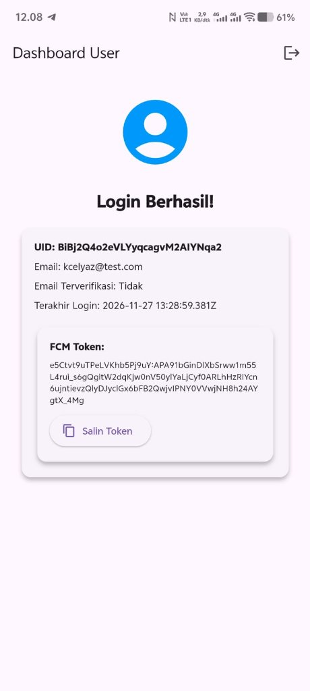
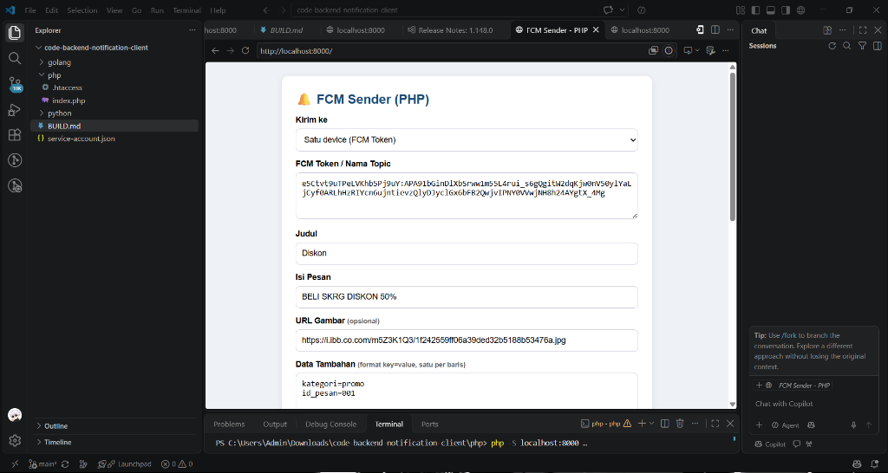
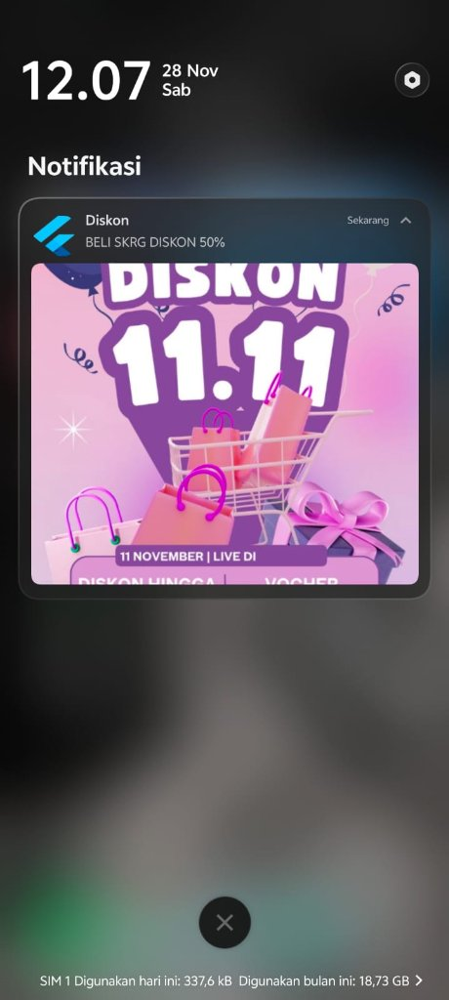
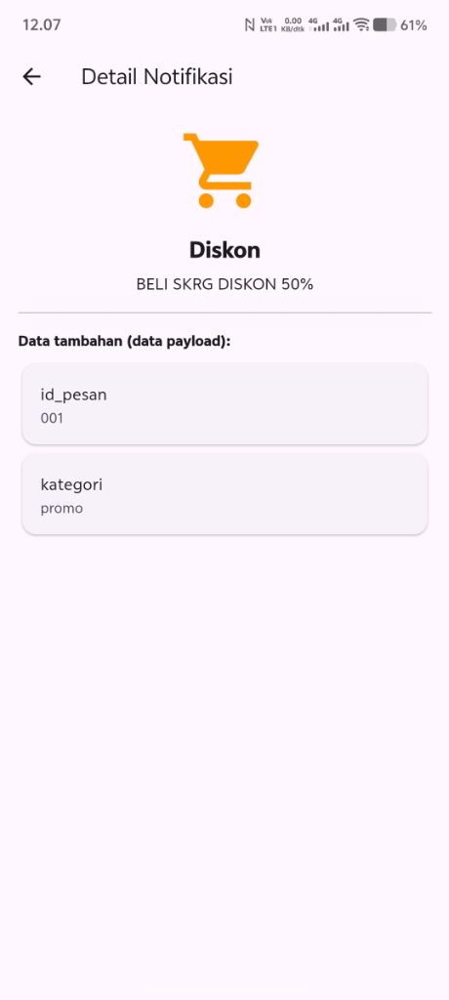
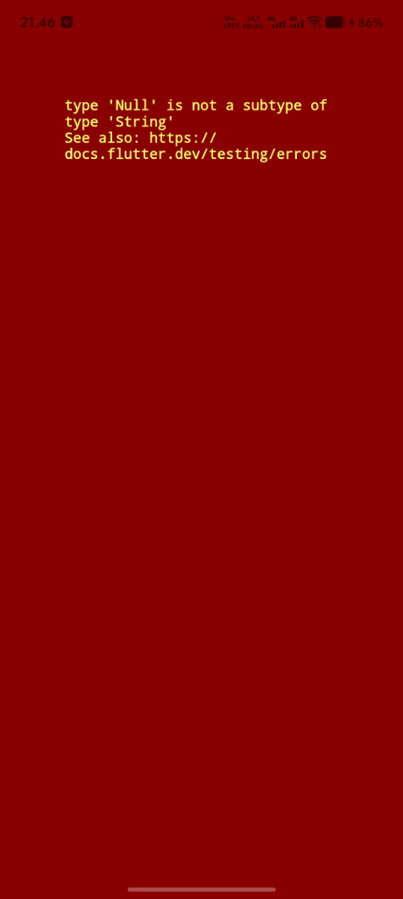

# Tugas Aplikasi Mobile 
 **Firebase Authentication** dan **Firebase Cloud Messaging (FCM)**.


- **Nama:** Ahmad Ilyas
- **NIM:** 1125170130
- **Kelas:** TI25KS
- **Prodi:** Teknik Informatika

---

## Alur Pengujian & Bukti Screenshot

### 1. Dashboard User & Pengambilan Token FCM
Setelah berhasil login, aplikasi langsung masuk ke halaman Dashboard. Di sini muncul data user (UID, email, status verifikasi) dan **card FCM Token**. Token perangkat ini tinggal disalin pakai tombol "Salin Token" buat ditempel ke web pengirim notifikasi.

<p align="center">
  
</p>

---

### 2. Kirim Notifikasi via Web PHP (FCM Sender)
Pengujian pengiriman notifikasi dilakukan menggunakan backend client berbasis PHP yang dijalankan secara lokal di `http://localhost:8000/`.

Di form ini diisi:
- **Token Tujuan:** Menempelkan token FCM dari HP yang disalin di Dashboard.
- **Judul:** Diskon
- **Isi Pesan:** BELI SKRG DISKON 50%
- **URL Gambar:** Link gambar promo banner diskon
- **Data Tambahan:** `kategori=promo` dan `id_pesan=001` (dikirim sebagai payload data untuk menguji logika Tugas 1).



---

### 3. Notifikasi Berhasil Diterima di HP (Status Bar)
Begitu tombol kirim ditekan di web PHP, notifikasi langsung masuk secara real-time ke notification tray / status bar HP lengkap dengan judul, isi teks, dan banner gambar promonya.

<p align="center">
  
</p>

---

### 4. Halaman Detail Notifikasi & Pengerjaan Tugas 1 (Icon Promo)
Saat banner notifikasi di status bar di-klik, aplikasi otomatis membuka halaman **Detail Notifikasi**:
- **Logika Tugas 1 Terpenuhi:** Karena pada payload data dikirim `"kategori": "promo"`, ikon di bagian atas otomatis berubah menjadi **keranjang belanja warna oranye** (`Icons.shopping_cart`), bukan ikon lonceng default.
- Data payload tambahan (`id_pesan: 001` dan `kategori: promo`) juga sukses ditampilkan di card data.

<p align="center">
  
</p>

---

### 5. Catatan Perbaikan Bug Gambar (Fix Layar Merah)
pas tahap awal pengerjaan, aplikasi sempat mengalami error layar merah,dengan pesan error:
```
type 'Null' is not a subtype of type 'String'
```

pas saya cari tau penyebabnya adalah pemanggilan langsung `Image.network(data["image"])` jadi pas nerima notifi teks/promo biasa yang gak menyertakan link gambar.

<p align="center">
  
</p>

**Solusi:**  
ditambahkan kondisi pengaman null check `if (data['image'] != null)` sebelum widget image dirender. Dengan begitu, aplikasi tetap berjalan lancar dan aman baik saat notifikasi memiliki gambar maupun tidak.

---

## Ringkasan Fitur
- **Firebase Auth:** Login email & password, Auth Gate otomatis (`StreamBuilder`), dan logout.
- **Firebase Cloud Messaging:** Pengambilan token FCM, penerima notifikasi foreground/background/terminated, serta navigasi langsung ke halaman detail saat notif di-klik.
- **Tugas 1:** Ikon detail berubah dinamis menjadi keranjang belanja jika menerima payload kategori promo.
- **Null Safety:** Proteksi rendering gambar agar halaman detail tidak crash saat data gambar null.

---

## Cara Menjalankan

1. Clone repositori:
   ```bash
   git clone https://github.com/elyazz10/Latihan-008-Aplikasi-Mobile.git
   ```
2. Ambil dependensi:
   ```bash
   flutter pub get
   ```
3. Pastikan file konfigurasi `google-services.json` sudah ada di folder `android/app/`.
4. Jalankan aplikasi:
   ```bash
   flutter run
   ```
